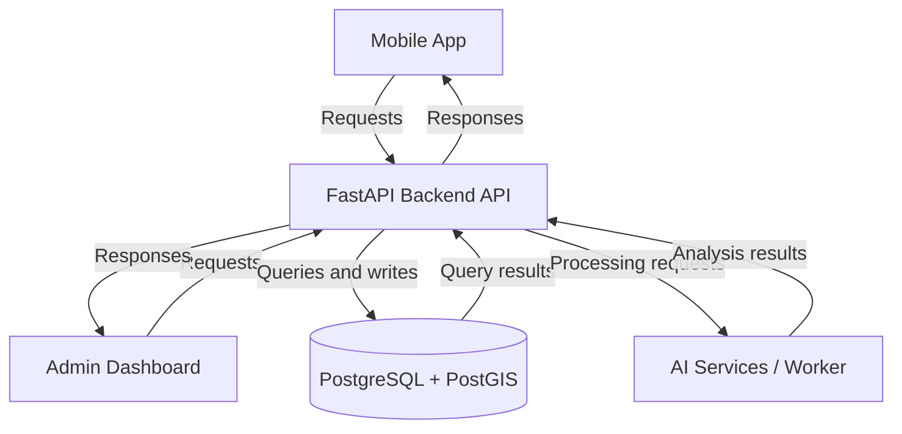

# Architecture

## Overview

The application uses a central **FastAPI backend** as the communication boundary between the clients, the database, and AI processing. The mobile app and admin dashboard do not connect directly to the database or AI services; they send requests to the API and receive responses from it.

## High-level architecture

The labels describe the logical data exchanged, not necessarily a single network protocol: client communication may use HTTP/JSON, database communication uses database queries/results, and AI processing may run asynchronously through a background job.

## Component responsibilities

| Component | Responsibilities |
|---|---|
| **Mobile app** | Lets personal users browse the map and submit observations. Report photos are captured through the in-app camera workflow rather than selected from the gallery. |
| **Admin dashboard** | Lets authorized administrators review reports and AI match suggestions, verify business accounts, and moderate events. |
| **FastAPI backend API** | Exposes endpoints, validates requests, enforces authentication and permissions, coordinates database operations, and initiates AI processing. It is the only application-facing access point for the clients. |
| **PostgreSQL + PostGIS** | Stores users, business profiles, observations, events, moderation history, and geospatial data. PostGIS supports location-aware queries and map filtering. |
| **AI services / worker** | Analyses observations and proposes potential duplicate-event matches. AI suggestions are not treated as proof and should not silently confirm a match. |

## Core architectural principles

- **The API owns access control.** Hiding a control in the frontend is not a substitute for server-side permission checks.
- **Clients do not access the database directly.** All application data access goes through the backend API.
- **Observations and events are distinct.** An observation preserves an individual submission; an event represents the current interpretation of an underlying incident or planned activity.
- **AI supports decisions.** The AI can propose match candidates, while confirmation follows the application's configured review policy.
- **Keep the initial system simple.** Begin with a modular FastAPI backend and a separate AI worker only when asynchronous processing is needed. Avoid adding independent services without a clear requirement.

## Planned data path

1. A mobile user or administrator sends a request to the FastAPI API.
2. The API validates the request and checks the user's permissions.
3. The API reads or writes data in PostgreSQL/PostGIS and, when needed, starts AI processing.
4. AI results return to the backend and are stored or exposed through the API according to the matching and moderation rules.
5. The API returns the appropriate response to the requesting client.