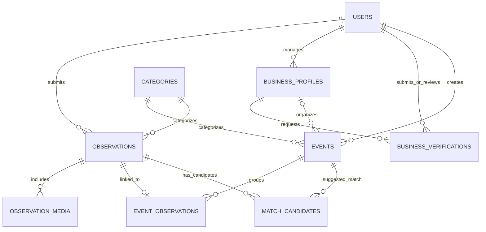

# TimiScope — Data Model

> **Status:** Initial design. These tables describe the proposed model, not necessarily the implemented database schema. Update this document alongside database migrations as the implementation evolves.

## 1. Core concepts

TimiScope distinguishes between an **observation** and an **event**:

- An **observation** is an individual report submitted by a user. It preserves what that person reported, when they submitted it, and where they said they observed it.
- An **event** is the shared record representing the underlying real-world occurrence or planned activity. Several observations may refer to the same event.
- **`event_observations`** records links that have been confirmed.
- **`match_candidates`** stores AI-suggested links that have not yet been confirmed.

This separation lets TimiScope group reports without overwriting the original submissions or treating an AI suggestion as fact.

## 2. Relationships at a glance

The diagram is conceptual. Exact constraints and cardinalities should be enforced in the database migrations.

## 3. Table definitions

### 3.1 `users`

Stores personal accounts, business-account users, and administrators. In the initial version, each user has one account role. Admin privileges must only be granted through a trusted server-side process.

| Column | PostgreSQL type | Constraints / notes |
|---|---|---|
| `id` | `UUID` | Primary key; generate with a trusted UUID generator or database function. |
| `email` | `VARCHAR(254)` | Required; unique; normalize before storing. Validate format and verify ownership through an email-confirmation flow. |
| `email_verified_at` | `TIMESTAMPTZ` | Nullable; set when email ownership has been verified. |
| `password_hash` | `TEXT` | Required for password-based login. Store a password hash produced by Argon2id or bcrypt, not a plain SHA-256 hash. Never store the original password. |
| `username` | `VARCHAR(32)` | Required; unique if usernames are public identifiers. Define a minimum length and allowed characters in application validation. |
| `role` | `VARCHAR(16)` | Required; allowed values: `personal`, `business`, `admin`. Enforce allowed values in the database and authorization in the API. |
| `created_at` | `TIMESTAMPTZ` | Required; defaults to the current time. |
| `updated_at` | `TIMESTAMPTZ` | Required; updated whenever the account profile changes. |
| `is_active` | `BOOLEAN` | Required; defaults to `TRUE`; supports disabling accounts without deleting audit history. |

### 3.2 `business_profiles`

Stores information about a business. Keeping this separate from `users` avoids placing company details on every user row and makes it possible to support multiple authorized business members later.

| Column | PostgreSQL type | Constraints / notes |
|---|---|---|
| `id` | `UUID` | Primary key. |
| `owner_user_id` | `UUID` | Required; foreign key to `users.id`. For a simple MVP, one owner manages the profile. A separate membership table can be added if multiple employees need access. |
| `name` | `VARCHAR(160)` | Required; legal or trading name. |
| `registration_number` | `VARCHAR(80)` | Nullable until supplied; business registration identifier where applicable. Consider uniqueness only after defining the relevant jurisdiction and identifier rules. |
| `contact_email` | `VARCHAR(254)` | Required; general business contact address. |
| `contact_phone` | `VARCHAR(32)` | Optional. |
| `address` | `TEXT` | Business address, not the owner's home address. Restrict access if it is not intended to be public. |
| `activity_description` | `VARCHAR(120)` | Short description of the business activity, such as food, entertainment, or education. |
| `about` | `TEXT` | Optional longer description. |
| `created_at` | `TIMESTAMPTZ` | Required; defaults to the current time. |
| `updated_at` | `TIMESTAMPTZ` | Required; updated when the profile changes. |

The current verification state should be obtained from the latest `business_verifications` record, or maintained as a carefully synchronized status if the application later requires it for efficient queries.

### 3.3 `business_verifications`

Stores each business verification application and the administrator's decision. Keeping applications separate from the profile preserves the review history if a business reapplies.

| Column | PostgreSQL type | Constraints / notes |
|---|---|---|
| `id` | `UUID` | Primary key. |
| `business_profile_id` | `UUID` | Required; foreign key to `business_profiles.id`. |
| `submitted_by` | `UUID` | Required; foreign key to `users.id`. The user must be authorized to manage this business profile. |
| `status` | `VARCHAR(24)` | Required; allowed values: `pending`, `approved`, `rejected`, `more_information_required`, `withdrawn`. |
| `submitted_at` | `TIMESTAMPTZ` | Required; defaults to the current time. |
| `reviewed_by` | `UUID` | Nullable; foreign key to `users.id`, set to the administrator who reviewed the application. |
| `reviewed_at` | `TIMESTAMPTZ` | Nullable; set when a review decision is made. |
| `review_reason` | `TEXT` | Nullable; explanation for rejection, additional-information requests, or other decisions. Avoid storing unnecessary sensitive details. |
| `updated_at` | `TIMESTAMPTZ` | Required; updated whenever the application changes. |

If applications need uploaded proof documents, add a `business_verification_documents` table with its own `id`, `verification_id`, `storage_key`, `document_type`, and `uploaded_at`. Keep the files in private storage, not in a public directory, and enforce access control.

**Important:** verifying a business account grants eligibility to create positive events; it does not automatically verify every event the business publishes.

### 3.4 `categories`

Stores categories such as infrastructure, road obstruction, concert, market, or education. Category and event type are separate concepts: for example, `event_type` may be `problem` or `positive`, while `category` describes the subject.

| Column | PostgreSQL type | Constraints / notes |
|---|---|---|
| `id` | `UUID` | Primary key. |
| `name` | `VARCHAR(80)` | Required; unique category name. |
| `description` | `TEXT` | Optional explanation shown to users. |
| `is_active` | `BOOLEAN` | Required; defaults to `TRUE`. Inactive categories are hidden from new submissions but remain on existing records. |
| `created_at` | `TIMESTAMPTZ` | Required; defaults to the current time. |

### 3.5 `observations`

Stores the original report submitted by a user. It should not be overwritten simply because it becomes linked to an event.

| Column | PostgreSQL type | Constraints / notes |
|---|---|---|
| `id` | `UUID` | Primary key. |
| `submitted_by` | `UUID` | Required; foreign key to `users.id`. |
| `category_id` | `UUID` | Nullable foreign key to `categories.id` if a report may initially be uncategorized. |
| `location` | `GEOGRAPHY(POINT, 4326)` | Required; geographic point using longitude/latitude coordinates. Add a GiST spatial index. |
| `observed_at` | `TIMESTAMPTZ` | When the user says the observation occurred; may differ from submission time. Decide whether users can edit this value. |
| `description` | `TEXT` | Required; description of what was observed. Validate length in the API. |
| `review_status` | `VARCHAR(24)` | Required; suggested values: `pending`, `approved`, `rejected`, `needs_information`. This is the moderation state of the report, not the event lifecycle. |
| `created_at` | `TIMESTAMPTZ` | Required; server-side submission time, defaults to the current time. |
| `updated_at` | `TIMESTAMPTZ` | Required; updated when editable report fields change. |

Avoid putting a single `media_id` on this table if one observation can have multiple photos. Use `observation_media` instead.

### 3.6 `observation_media`

Stores metadata for photos attached as evidence to an observation. The actual photo should be stored in private file/object storage; the database keeps a storage reference and relevant metadata.

| Column | PostgreSQL type | Constraints / notes |
|---|---|---|
| `id` | `UUID` | Primary key. |
| `observation_id` | `UUID` | Required; foreign key to `observations.id`. |
| `storage_key` | `TEXT` | Required; private storage key or path, not a publicly accessible URL. |
| `mime_type` | `VARCHAR(100)` | Required; determined by validating the file contents, not trusting only the client-provided value. |
| `file_hash` | `VARCHAR(128)` | Required; cryptographic file hash for detecting exact duplicate files. A hash does not establish that a photo is authentic. |
| `captured_at` | `TIMESTAMPTZ` | Nullable; capture time supplied by the app/workflow. Treat it as metadata, not proof that a photo is genuine or current. |
| `capture_session_id` | `UUID` | Nullable; identifier for the in-app camera capture workflow, if implemented. It is traceability metadata, not proof that a client cannot be bypassed. |
| `created_at` | `TIMESTAMPTZ` | Required; time the media record was stored. |

The personal reporting flow should open the in-app camera and not provide a gallery picker. The API must still validate uploads because client-side restrictions can be bypassed.

### 3.7 `events`

Stores the shared record for an underlying occurrence or planned activity. Problem events may be created after reviewing observations; positive events may be submitted by verified businesses.

| Column | PostgreSQL type | Constraints / notes |
|---|---|---|
| `id` | `UUID` | Primary key. |
| `title` | `VARCHAR(180)` | Required; short event title. |
| `summary` | `TEXT` | Optional summary of the event. Keep original observation descriptions in `observations`. |
| `event_type` | `VARCHAR(24)` | Required; suggested values: `problem`, `positive`, `informational`. |
| `category_id` | `UUID` | Required foreign key to `categories.id`. |
| `location` | `GEOGRAPHY(POINT, 4326)` | Required; event's current representative location. Add a GiST spatial index. |
| `status` | `VARCHAR(24)` | Required; lifecycle values such as `active`, `resolved`, `cancelled`, `archived`. Define which values apply to each event type. |
| `publication_status` | `VARCHAR(24)` | Required; suggested values: `draft`, `pending_review`, `published`, `rejected`, `cancelled`. Controls whether the event is publicly visible. |
| `verification_level` | `VARCHAR(24)` | Required; suggested values: `unreviewed`, `community_supported`, `moderator_reviewed`. This expresses review/evidence level, not certainty that every claim is true. |
| `created_by` | `UUID` | Required; foreign key to `users.id`. |
| `business_profile_id` | `UUID` | Nullable foreign key to `business_profiles.id`; set when a business organizes the event. Only a currently verified and authorized business may create eligible positive events. |
| `start_at` | `TIMESTAMPTZ` | Nullable for events without a planned start time; useful for future positive events. |
| `end_at` | `TIMESTAMPTZ` | Nullable; if supplied, validate that it is later than `start_at`. |
| `created_at` | `TIMESTAMPTZ` | Required; defaults to the current time. |
| `updated_at` | `TIMESTAMPTZ` | Required; updated when event details change. |

Keep `status`, `publication_status`, and `verification_level` separate because they answer different questions: what stage the event is in, whether it is visible, and what level of review it has received.

### 3.8 `event_observations`

This is a **junction/link table** that records which observations have been confirmed as belonging to which event. It does not store the full observation again.

| Column | PostgreSQL type | Constraints / notes |
|---|---|---|
| `event_id` | `UUID` | Required; foreign key to `events.id`. |
| `observation_id` | `UUID` | Required; foreign key to `observations.id`. |
| `linked_at` | `TIMESTAMPTZ` | Required; time the association was confirmed. |
| `linked_by` | `UUID` | Nullable foreign key to `users.id`; moderator or authorized actor who confirmed the link. Can be nullable if an explicitly approved automated policy creates the link. |
| `link_source` | `VARCHAR(24)` | Required; suggested values: `moderator`, `user_confirmation`, `automated_policy`. |

Use `(event_id, observation_id)` as the composite primary key to prevent duplicate links. For the MVP, if each observation may belong to at most one confirmed event, also add a unique constraint on `observation_id`. Remove that constraint only if the product later needs an observation to be associated with multiple events.

### 3.9 `match_candidates`

Stores AI-suggested possible matches before they become confirmed links. Separating these suggestions from `event_observations` prevents uncertain predictions from being mistaken for confirmed relationships.

| Column | PostgreSQL type | Constraints / notes |
|---|---|---|
| `id` | `UUID` | Primary key. |
| `observation_id` | `UUID` | Required; foreign key to `observations.id`. The new report being matched. |
| `candidate_event_id` | `UUID` | Required; foreign key to `events.id`. The event proposed as a possible match. |
| `score` | `NUMERIC(6,5)` | Nullable; optional model score between `0` and `1`. Document how the score is calculated; do not call it a probability unless calibrated. |
| `status` | `VARCHAR(24)` | Required; suggested values: `proposed`, `accepted`, `rejected`, `deferred`. |
| `model_name` | `VARCHAR(120)` | Nullable; model or matching method that produced the candidate. |
| `model_version` | `VARCHAR(120)` | Nullable; version identifier for reproducibility. |
| `reason` | `TEXT` | Nullable; concise explanation or review context. Avoid storing unnecessary personal data. |
| `reviewed_by` | `UUID` | Nullable foreign key to `users.id`. |
| `reviewed_at` | `TIMESTAMPTZ` | Nullable; when a review decision was made. |
| `created_at` | `TIMESTAMPTZ` | Required; defaults to the current time. |

When a candidate is accepted, create the corresponding `event_observations` row as part of the same transaction and update the candidate status. Rejecting a candidate should not delete the original observation.