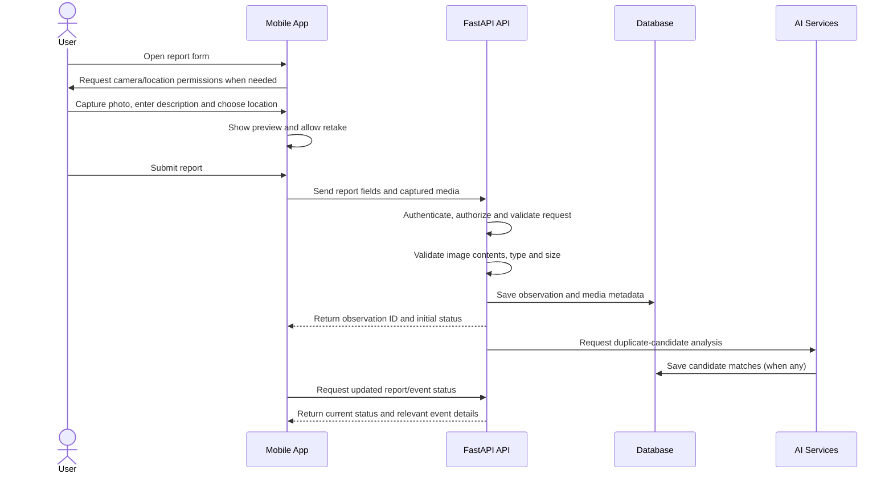
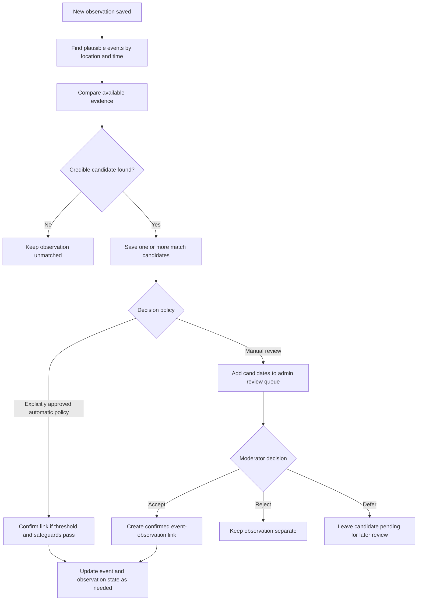
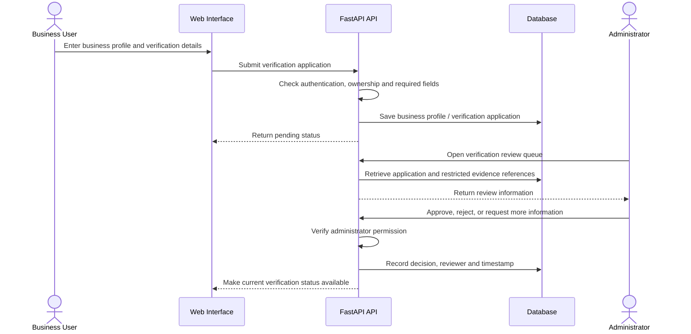
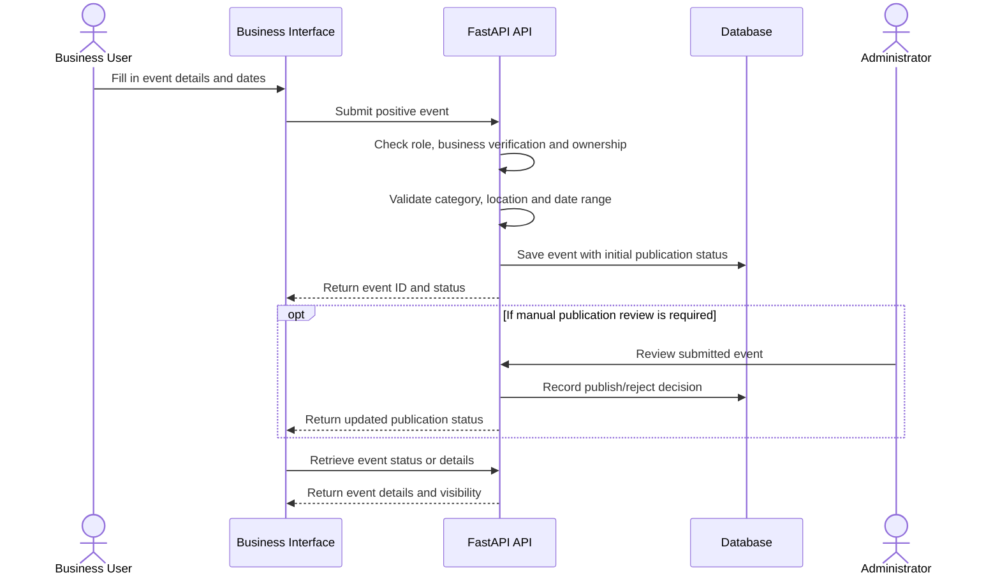
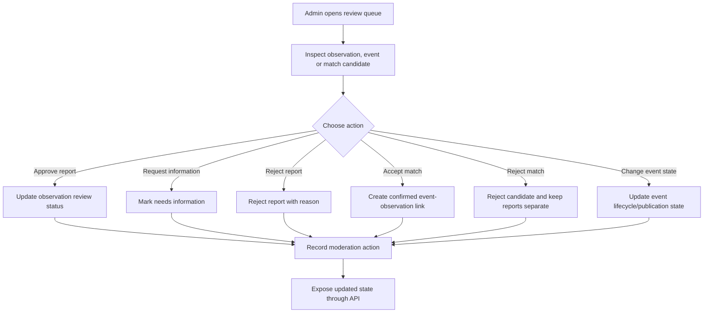
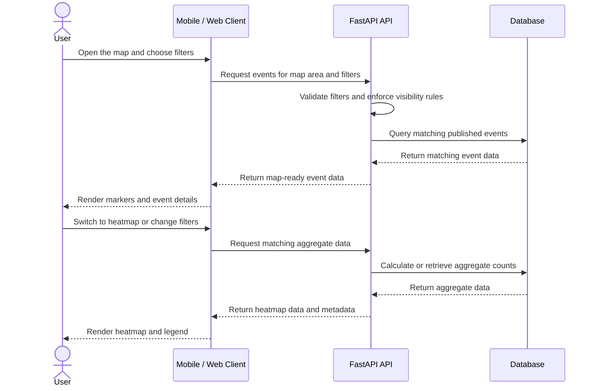

# TimiScope — Workflows

> **Status:** Draft. These workflows describe the intended behavior of TimiScope. They are design proposals, not proof that the corresponding features have been implemented. Update this document as requirements, API routes, and database migrations become more concrete.

## 2. Actors and responsibilities

| Actor / component | Main responsibilities |
|---|---|
| Personal user | Browse the map and submit observations about problems in the city. |
| Business user | Manage a business profile, apply for verification, and—once verified—submit positive events such as activities the business organizes. |
| Administrator | Review business verification applications, moderate content, and review uncertain AI match suggestions. |
| Mobile app | Provide the personal reporting flow, including taking report photos inside the app rather than selecting them from the gallery. |
| Web interface | Provide map exploration and the appropriate business and administration screens. The exact separation of these screens is still to be decided. |
| FastAPI backend | Validate requests, authenticate users, enforce permissions, persist data, and coordinate processing. |
| Database | Store accounts, observations, media metadata, events, candidate matches, verification decisions, and history. |
| AI services / worker | Suggest possible duplicate-event matches. AI output is evidence for review, not proof that two reports refer to the same event. |

## 3. Shared concepts and rules

TimiScope uses several independent status dimensions. They should not be combined into one general-purpose `status` field.

| Dimension | Example values | Question answered |
|---|---|---|
| Observation review status | `pending`, `approved`, `rejected`, `needs_information` | Has this submitted report been reviewed? |
| Event publication status | `draft`, `pending_review`, `published`, `rejected`, `cancelled` | Should this event be visible to the public? |
| Event lifecycle status | `active`, `resolved`, `cancelled`, `archived` | What is the current state of the underlying incident or activity? |
| Event verification level | `unreviewed`, `community_supported`, `moderator_reviewed` | What kind of review or supporting evidence does the event have? |
| Match candidate status | `proposed`, `accepted`, `rejected`, `deferred` | What happened to an AI-suggested link? |
| Business verification status | `pending`, `approved`, `rejected`, `more_information_required`, `withdrawn` | Is this business eligible for business-only actions? |

These are proposed values based on the initial data model. Keep them synchronized with the actual schema and define valid transitions in application code and tests.

### Important rules

1. An **observation** is an individual submission. An **event** is the shared record representing an incident or planned activity.
2. `match_candidates` contains suggested links. `event_observations` contains confirmed links.
3. A business being verified does not automatically mean that every event it submits is approved or factually verified.
4. Only the backend grants access to protected operations. Client-side buttons and screens are not a security boundary.
5. A report photo must be captured using the in-app camera workflow. This reduces some abuse opportunities, but does not prove that the image is genuine, recent, or taken at the reported location.
6. Public maps and heatmaps represent reports available to TimiScope. They are not guaranteed to represent every condition in the city.

---

## 4. Workflow A — A personal user submits a problem report

### Goal

Allow a user to report a problem at a specific location, optionally attaching a photo captured within the app. Preserve the original submission even if the system later associates it with an existing event.

### Flow

### Steps

1. The user opens the report form in the mobile app.
2. The app requests camera and location permissions only when required. The user enters a description and selects or confirms the report location.
3. The user takes a photo inside the app. The app shows a preview and offers a retake option. There is no gallery-picker option for report evidence.
4. On submission, the API checks authentication, input limits, location values, and file contents. It must not trust a file extension or MIME type supplied only by the client.
5. The API stores the observation and the media metadata. The photo itself is stored in the configured private media storage, rather than as raw image data in the observation row.
6. The API returns an observation ID and a clear initial status. Slow matching work should not keep the submission request open unnecessarily.
7. AI processing may suggest possible existing events. The report remains stored even if processing fails or no candidate is found.

### Expected outcomes

- **Accepted for processing:** the observation is saved and its review status indicates what happens next.
- **Invalid submission:** the API returns a validation error and explains which field or upload needs correction.
- **Authentication / permission failure:** the API rejects the request without creating an observation.
- **AI processing failure:** the observation remains available; the matching job can be retried or reviewed separately.

---

## 5. Workflow B — AI suggests a duplicate event match

### Goal

Determine whether a new observation may refer to an event that is already in TimiScope, while keeping uncertain matches separate until the configured decision policy accepts them.

### Flow

### Steps

1. The AI service receives an observation that has already been stored by the API.
2. The system first narrows the candidate set using plausible geographic and temporal limits. It then compares evidence such as category and text, and optionally image similarity.
3. The service saves candidate records in `match_candidates`, including the method/model version and score where available.
4. If there are no credible candidates, the observation stays unmatched. **A policy must decide whether it creates a new provisional event immediately or waits for moderator review.**
5. For manual review, an administrator compares the new observation with the proposed event and its existing observations.
6. If the administrator accepts a candidate, the backend creates a row in `event_observations` and updates the candidate's status. These changes should occur in one database transaction so the candidate decision and confirmed link cannot disagree.
7. If the candidate is rejected, the observation remains separate. If deferred, the system records that no final decision has been made yet.

### Decision guidance

| Situation | Suggested behavior |
|---|---|
| High similarity, plausible location and time | Present the candidate for review; automatic linking should only be enabled after evaluation and explicit policy design. |
| Some evidence matches but the case is ambiguous | Queue for moderator review. |
| No credible existing event | Keep the observation unmatched and apply the chosen new-event policy. |
| AI service unavailable | Retain the observation and retry processing or leave it for manual handling. |

### Important safeguards

- A similarity score is not automatically a calibrated probability.
- Geographical proximity alone is not enough to merge reports; multiple different events can happen close together.
- Do not discard original descriptions or media when two observations are linked.
- Record consequential moderator decisions so matching errors can be investigated and evaluated.

### Decisions to confirm

- Will all matches require manual confirmation in the MVP, or will a carefully evaluated high-confidence path be allowed to link automatically?
- When no match is found, should TimiScope create a provisional event or leave the report unmatched until review?
- Who can reverse an accepted link, and how should that action be audited?

---

## 6. Workflow C — A business applies for verification

### Goal

Allow a business to request permission to publish positive events. The business must be reviewed before receiving those privileges.

### Flow

### Steps

1. A signed-in user submits business information, such as the business name and contact details, plus any evidence required by the verification policy.
2. The API checks required fields and confirms that the user is authorized to manage the business profile.
3. The verification application is saved with `pending` status. Verification documents, if used, remain private and are accessible only to authorized reviewers.
4. An administrator reviews the submitted information and chooses one of the allowed outcomes: approve, reject, or request more information.
5. The API records who made the decision, when it was made, and an appropriate reason. The application history should be retained if a business reapplies.
6. Only an approved, currently eligible business profile grants permission to create positive events.

### Expected outcomes

- **Approved:** the business becomes eligible to perform the business-only actions defined by the product.
- **Rejected:** the business cannot create positive events using verified-business privileges; the decision reason is retained according to the privacy policy.
- **More information required:** the business can update the application and resubmit it.
- **Unauthorized review action:** the API rejects the operation and records it as appropriate for the security audit policy.

### Decisions to confirm

- What proof is required for businesses in the MVP, and who can access it?
- Can one user manage more than one business profile?
- Can an approved business lose verification later, and what happens to its already-published events if that occurs?

---

## 7. Workflow D — A verified business submits a positive event

### Goal

Let a verified business create a future event it organizes, such as a concert, market, workshop, or community activity.

### Flow

### Steps

1. An authorized business user enters the event title, description, category, location, start/end time, and any approved public-facing media.
2. The API verifies that the user can manage the business profile and that the profile is currently verified. It does not rely on a client-supplied role or verification flag.
3. The API validates the submitted fields, including the date range and supported category, then records the event with the appropriate organizer and initial publication status.
4. If the chosen policy requires administrator approval, the event remains `pending_review` until an authorized decision is made. Otherwise, the system may publish qualifying submissions from verified businesses under a separately defined policy.
5. The map displays the event only when its publication status and time-related rules make it eligible for public display.
6. The business can view its own event and, subject to the final product rules, edit or cancel it. Material edits may require another review.

### Suggested event fields

- Event type: `positive`.
- Category: for example, concert, market, education, or community activity.
- Organizer: the associated `business_profile_id`.
- Location and event start/end times.
- Publication status and event lifecycle status, kept separate.

### Decisions to confirm

- Are all positive events moderated before publication, or can verified businesses publish immediately?
- Which edits require re-review after publication?
- What public media can businesses upload, and how is it distinguished from user-submitted evidence photos?
- What should happen if the business loses verification after publication?

---

## 8. Workflow E — An administrator moderates a report or event

### Goal

Give administrators a controlled way to handle harmful, misleading, duplicate, or otherwise unsuitable content, while preserving an audit trail.

### Flow

### Rules

1. Only an authenticated administrator can perform administrator-only actions.
2. The API validates that the requested transition is allowed; it does not accept arbitrary status strings.
3. Important actions record the actor, target, action, timestamp, and reason where appropriate.
4. Rejecting an observation or match candidate does not delete original evidence automatically.
5. An event's publication status, lifecycle status, and verification level are updated independently according to explicit rules.
6. Administrators should be able to understand what was changed and why, without exposing private business verification documents or unnecessary user information.

### Decisions to confirm

- Can a report be approved while the event it refers to remains unpublished?
- Which actions require a reason?
- Which administrator actions can be undone, and should undo operations create new audit records rather than erasing history?

---

## 9. Workflow F — A user explores the map

### Goal

Let users explore published information and filter it by event type, category, time, status, and other supported criteria.

### Flow

### Rules

- The client requests only the event data needed for the visible map area and selected filters.
- The backend decides which events are public. A client must not be able to retrieve unpublished events merely by changing a request parameter.
- `event_type` and `category` are different filters. For example, a user may select positive events and then narrow the results to concerts.
- A marker cluster groups nearby map markers for readability; a heatmap shows the concentration of records within the chosen filters. They are not the same visualization.
- The interface should explain the meaning of colors, icons, dates and verification labels. Do not rely on color alone to communicate event type.
- Heatmaps should be described as concentrations of available reports/events, not as definitive measures of danger or overall city conditions.

---

## 10. Shared error and recovery behavior

| Situation | Expected behavior |
|---|---|
| API request is invalid | Return a clear validation error; do not save a partial record unless the workflow explicitly supports drafts. |
| User lacks permission | Reject the action server-side. Do not reveal private data in the error response. |
| Database write fails | Return an error and avoid reporting the operation as successful. Use transactions for related writes. |
| AI processing fails | Keep the observation; record or expose a retryable processing state rather than losing the report. |
| Photo is too large or invalid | Reject the upload and explain the limit or allowed format. |
| Two moderators act on the same item | Re-check the current state when saving; avoid silently overwriting a newer decision. |
| Business verification is revoked | Block future protected actions and apply the product's defined policy to existing listings. |
| No events match the map filters | Return an empty result with valid metadata, not a server error. |

## 11. Workflow implementation checklist

- [ ] Personal user can submit an observation from the in-app camera workflow.
- [ ] Observation and media metadata are stored and can be retrieved.
- [ ] AI matching creates candidate records without treating them as confirmed links.
- [ ] An authorized moderator can accept, reject, or defer a match candidate.
- [ ] Business verification can be submitted and reviewed with an auditable decision.
- [ ] Only eligible verified businesses can submit positive events.
- [ ] Event publication and lifecycle statuses are enforced independently.
- [ ] The map supports positive/problem filters and shows only eligible public events.
- [ ] Heatmap results respond to the selected filters and explain what they measure.
- [ ] Authorization, invalid inputs, failed processing, and concurrent moderation actions are tested.

---
